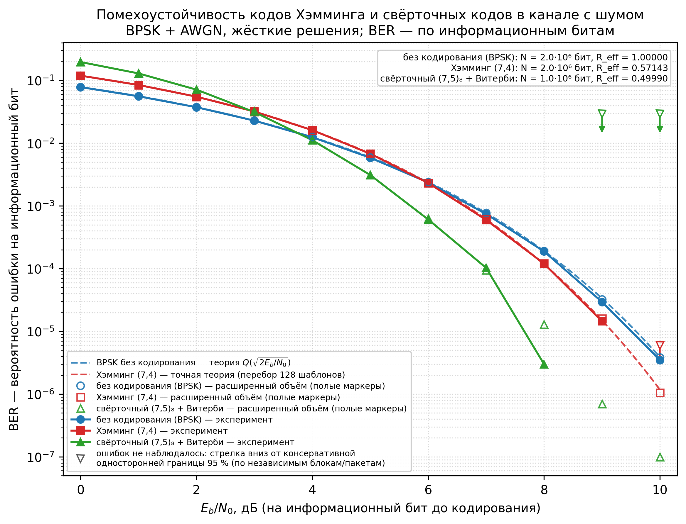

# Исследование помехоустойчивости кодов Хэмминга и свёрточных кодов при передаче данных по каналу с шумом


Сравниваю три режима передачи в канале AWGN (по сути это белый шум) с модуляцией BPSK.
Решения везде **жёсткие**: демодулятор выдаёт только 0 или 1 и не говорит, насколько
символ был надёжным.

| Режим | Код | Скорость R | Декодирование |
|-------|-----|-----------|----------------|
| 1 | без кодирования | 1 | — |
| 2 | Хэмминг (7,4) | 4/7 | синдромное, исправляет одну ошибку в блоке |
| 3 | свёрточный, K=3, (7,5)₈ | L/(2(L+2)) ≈ 0.4999 | Витерби, жёсткие решения |

Свёрточный код — это когда выходные биты зависят не только от текущего входного, но и
от предыдущих: у кодера есть память на K − 1 = 2 бита. Хэмминг (7,4) проще — он берёт
4 информационных бита, добавляет 3 проверочных и умеет исправить одну ошибку в
семибитовом слове.



## О чём работа

Хочется понять, сколько реально даёт кодирование: насколько оно снижает вероятность
ошибки на бит (BER) по сравнению с передачей без кода. Ответ принято давать в
децибелах — это «энергетический выигрыш»: на сколько дБ меньше отношения Eb/N0 нужно
кодированной системе, чтобы ошибаться так же часто, как некодированной.

Всё реализовано вручную: кодер и декодер Хэмминга, свёрточный кодер, декодер Витерби,
канал, статистика и графики. Сторонние библиотеки помехоустойчивого кодирования не
используются. Рядом лежат тесты, сохранённые данные прогонов и рисунки, так что
результат можно повторить у себя.

## Что нужно для запуска

* Python 3.10 или новее. Основной прогон сделан на 3.13.16. На 3.11.2 проверено
  отдельно: 119 тестов OK, `qa_check` 16/16, перегенерация основного отчёта из
  сохранённых CSV повторяет все числа (отличается только шапка с датой и версиями).
* NumPy 1.24+ и Matplotlib 3.7+.
* Jupyter Notebook или VS Code с расширением Jupyter — нужен только для notebook.
* `scipy` **не** требуется: Q-функция считается через `math.erfc` из стандартной
  библиотеки.

## Установка

```bash
git clone https://github.com/FaHaT-TM/Hamming-code.git
cd Hamming-code
python -m venv venv
source venv/bin/activate          # Windows: venv\Scripts\activate
pip install -r requirements.txt
```

## Структура

```
Hamming-code/
├── notebooks/01_research.ipynb     # главный документ: 19 разделов, переисполняется
├── src/
│   ├── hamming.py                  # код Хэмминга (7,4)
│   ├── convolutional.py            # свёрточный кодер R=1/2, K=3, (7,5)₈
│   ├── viterbi.py                  # декодер Витерби (жёсткие решения, пакетный)
│   ├── channel.py                  # BPSK, AWGN, жёсткий демодулятор
│   ├── metrics.py                  # BER, интервалы, теория, энергетический выигрыш
│   ├── simulation.py               # план эксперимента, счётчики, CSV
│   └── plotting.py                 # все графики — только из сохранённых CSV
├── tests/                          # 119 тестов, стандартный unittest
├── scripts/
│   ├── run_experiment.py           # полный/быстрый эксперимент, замер производительности
│   ├── make_figures.py             # графики из CSV
│   ├── make_report_tables.py       # таблицы из CSV + energy_gain.csv
│   ├── verify_hamming_spec.py      # результаты проверки кода Хэмминга
│   ├── verify_viterbi.py           # короткие тесты Витерби со счётчиками случаев
│   ├── check_histograms.py         # 4 тождества гистограмм Z_j по всем строкам CSV
│   ├── run_refinement.py           # уточняющий прогон по сетке 0.2 дБ (отдельный seed)
│   ├── refinement_analysis.py      # выигрыш и интервалы по уточняющему набору
│   ├── build_notebook.py           # пересборка notebook
│   ├── make_presentation.py        # презентация к защите (pptx)
│   └── qa_check.py                 # контроль качества по 16 пунктам
├── results/
│   ├── data/                       # CSV, JSON (коммитятся: они маленькие и нужны для графиков)
│   └── figures/                    # PNG + PDF
├── документы/                      # вся текстовая документация (названия по-русски)
│   ├── Архитектура_проекта.md
│   ├── Математические_спецификации.md
│   ├── Спецификации_свёрточного_кода.md
│   ├── Состояние_тестов.md, Контроль_качества.md, Вопросы_к_защите.md
│   ├── отчёты/                     # Отчёт_по_результатам.md и отдельные проверки
│   └── презентация/                # Презентация_защиты.pptx (+ PDF и превью)
├── requirements.txt
└── .gitignore
```

## Запуск: быстрый старт

### Интерактивное меню (самый простой способ)

```bash
python scripts/menu.py
```

Меню в обычном терминале: установка зависимостей, тесты, контроль качества,
эксперименты, проверки кодов, графики, отчёт, notebook и презентация —
каждый пункт запускает соответствующий скрипт проекта и показывает его вывод.
Первый пункт меню ставит все нужные библиотеки из `requirements.txt`
в текущее окружение. Для разовых запусков без меню есть режим
`python scripts/menu.py run tests` (список действий: `python scripts/menu.py --list`).


### 1. Тесты

Тесты запускаются только из корня репозитория и только такой командой — иначе не
найдётся пакет `src`:

```bash
python -m unittest discover -s tests -t . -v
# Ran 119 tests ... OK
```

### 2. Notebook

Откройте `notebooks/01_research.ipynb` в VS Code или Jupyter и выполните все ячейки
(Run All). Notebook работает с **уже сохранёнными** результатами и короткими
демонстрационными прогонами — полный эксперимент он не запускает, так что считается
быстро.

Проверка исполнения из командной строки:

```bash
jupyter nbconvert --to notebook --execute notebooks/01_research.ipynb \
    --output 01_research.ipynb --ExecutePreprocessor.timeout=1800
```

Править `.ipynb` руками не нужно: он собирается скриптом `scripts/build_notebook.py`,
и ручные правки затрутся при следующей сборке.

### 3. Полный эксперимент (запускается явно)

Это самая долгая часть, поэтому она не вызывается ни тестами, ни notebook:

```bash
python scripts/run_experiment.py --probe   # замер производительности, ~1 с, в статистику не входит
python scripts/run_experiment.py           # основной + расширенный объём, ~5 мин на 2 vCPU
python scripts/run_experiment.py --main    # только основной план, ~30 с
```

План фиксированный: он задан в `src/simulation.py` (класс `Plan`) и не подбирался по
результатам.

| Схема | N_info на точку | Независимых единиц |
|-------|-----------------|--------------------|
| без кодирования | 2·10⁶ бит | 2·10⁶ бит |
| Хэмминг (7,4) | 2·10⁶ бит | 500 000 блоков |
| свёрточный | 10⁶ бит | 100 пакетов по L = 10 000 |

Диапазон Eb/N0 = 0…10 дБ, шаг 1 дБ, seed = 20261024. Расширенный прогон
(20·10⁶ / 20·10⁶ / 10·10⁶ бит) пишется в отдельный CSV со своим seed = 20261025 —
с основным набором он не объединяется.

«Независимая единица» здесь важна: у некодированной передачи это бит, у Хэмминга —
блок из 4 информационных бит, у свёрточного кода — пакет из L = 10 000 бит, потому что
внутри пакета ошибки связаны между собой. Доверительные интервалы считаются именно по
независимым единицам.

### 4. Графики, таблицы и неопределённость из сохранённых данных

Эти скрипты ничего не моделируют заново — они читают готовые CSV:

```bash
python scripts/make_figures.py         # results/figures/*.png и *.pdf (включая ber_zoom)
python scripts/make_report_tables.py   # отчёт, energy_gain.csv, cluster_intervals.csv
python scripts/verify_viterbi.py       # короткие тесты Витерби со счётчиками случаев
python scripts/check_histograms.py     # 4 тождества гистограмм по всем строкам CSV
python scripts/run_refinement.py       # уточняющий прогон 0.2 дБ, ~2 мин (seed 20261026)
python scripts/refinement_analysis.py  # выигрыш по уточняющему набору
python scripts/qa_check.py             # контроль качества по 16 пунктам, ждём 16/16
```

Отдельно про `make_report_tables.py`: он пересчитывает кластерные стандартные ошибки,
кластерные интервалы и bootstrap-неопределённость выигрыша из сохранённых гистограмм
`Z_j` (столбец `z_hist` в CSV). Bootstrap — это когда данные много раз перемешивают с
возвращением и смотрят разброс результата: здесь 10 000 реплик, seed 777001 (свой,
отдельный от seed эксперимента). В отчёт попадает и диагностика — сколько реплик
оказалось невалидными и в какой доле реплик менялась пара соседних точек сетки.

## Результаты

Файлы с данными:

* `results/data/ber_results.csv` — основной прогон;
* `results/data/ber_results_extended.csv` — расширенный объём;
* `results/data/ber_refinement.csv` — уточняющий прогон по сетке 0.2 дБ (отдельный набор);
* `results/data/refinement_gains.csv`, `refinement_cluster.csv` — выигрыш и интервалы по нему;
* `results/data/histogram_checks.json` — проверка 4 тождеств гистограмм;
* `results/data/theory_curves.csv` — теория BPSK и точная теория Хэмминга;
* `results/data/energy_gain.csv` — выигрыш: точечная оценка, bootstrap CI, диагностика;
* `results/data/cluster_intervals.csv` — кластерные и консервативные интервалы по точкам;
* `results/data/performance_probe.json` — замер производительности;
* `results/figures/ber_comparison.{png,pdf}` — сравнительный график BER(Eb/N0);
* `results/figures/ber_zoom.{png,pdf}` — окрестность BER = 10⁻⁴ по сетке 0.2 дБ;
* `results/figures/{channel_scheme,state_diagram,trellis_example,hamming_correction}.*` —
  схема канала, диаграмма состояний, пример решётки, исправление ошибки Хэммингом.

В CSV по каждой точке лежат: схема, Eb/N0, seed, `N_info`, `N_tx`, число ошибок `E`,
`BER = E/N_info` (без округления), число независимых единиц `M`, число единиц с
ошибками `K`, `ΣZ²`, `R_nominal`, `R_eff`, `σ²`, тип и уровень доверительного
интервала, время и статус.

**Что получилось (жёсткие решения, выигрыш округлён до 0.1 дБ).** При BER = 10⁻⁴
свёрточный код (7,5)₈ с Витерби даёт **+1.4 дБ**, код Хэмминга (7,4) — **+0.3 дБ**.
То есть некодированной передаче понадобилось бы примерно на 1.4 дБ больше мощности,
чтобы ошибаться так же часто, как свёрточному коду. У Хэмминга выигрыш маленький.

Более точно, по наборам:

| Набор | Хэмминг (7,4) | свёрточный (7,5)₈ + Витерби |
|---|---|---|
| уточняющая сетка 0.2 дБ | +0.32 [+0.29; +0.34] дБ | +1.39 [+1.34; +1.43] дБ |
| расширенный, сетка 1 дБ | +0.27 [+0.24; +0.30] дБ | +1.39 [+1.34; +1.45] дБ |

Интервалы — bootstrap 95 % по 10 000 реплик. При Eb/N0 ≲ 4 дБ кодирование проигрывает:
избыточность снижает энергию на информационный бит сильнее, чем даёт исправление
ошибок. Точки, где ошибок не наблюдалось совсем, приводятся с консервативной верхней
границей 95 %, а не как «BER = 0».

**Неопределённость разделена на три источника, и они не складываются:**

1. статистическая — bootstrap по независимым блокам и пакетам, 10 000 реплик;
2. сеточная и интерполяционная — разница между способами интерполяции: 0.10 дБ для
   Хэмминга и 0.19 дБ для свёрточного кода; плюс сеточная ошибка самой процедуры на
   точных теоретических кривых: −0.026 дБ для BPSK и −0.008 дБ для Хэмминга на сетке
   1 дБ;
3. редкие события — при K < 30 нормальная аппроксимация не применяется, остаётся
   только консервативная граница.

## Воспроизведение графиков

Графики строятся **только** из сохранённых CSV — канал в `plotting.py` заново не
считается. При том же seed повторный запуск `scripts/run_experiment.py` даёт те же
числа; это проверяют тесты `tests/test_simulation.py::TestReproducibility`.

## Документация

* `документы/Архитектура_проекта.md` — архитектура и принятые решения;
* `документы/Математические_спецификации.md` — математические спецификации (Q1–Q12);
* `документы/Спецификации_свёрточного_кода.md` — математические спецификации (Q3–Q11);
* `документы/отчёты/Отчёт_по_результатам.md` — основной отчёт: таблицы, интервалы, выигрыш;
* `документы/отчёты/Результаты_проверки_Хэмминга.md` — результаты проверки кода Хэмминга;
* `документы/Состояние_тестов.md` — фактическое состояние тестов и прогонов;
* `документы/Контроль_качества.md` — контроль качества по 16 пунктам ТЗ;
* `документы/отчёты/Уточняющий_прогон.md` — уточняющий прогон 0.2 дБ;
* `документы/отчёты/Проверка_гистограмм.md` — проверка тождеств гистограмм по всем строкам;
* `документы/отчёты/Проверка_декодера_Витерби.md` — короткие тесты декодера со счётчиками;
* `документы/презентация/Презентация_защиты.pptx` — презентация для защиты (16 слайдов;
  генерация — `scripts/make_presentation.py`, для неё нужен необязательный `python-pptx`);
* `документы/Вопросы_к_защите.md` — возможные вопросы на защите и ответы на них.

Отчёты в `документы/отчёты/` — производные: их генерируют скрипты из
`results/data/*.csv`. Поэтому править нужно скрипт-генератор
(`make_report_tables.py`, `check_histograms.py`, `verify_viterbi.py`,
`refinement_analysis.py`, `verify_hamming_spec.py`), а не готовый файл: следующая
перегенерация затрёт ручную правку.

## Ограничения

Моделируются только два кода и только жёсткое декодирование — мягкие решения не
рассматривались, поэтому про выигрыш от них здесь ничего не утверждается. Канал —
идеальный AWGN, без замираний и стираний. Теоретическая кривая для свёрточного кода не
строилась. Интервалы для кодированных схем консервативны по построению и могут быть
широкими: конструкция q/ℓ ≤ P_b ≤ q намеренно отбрасывает информацию о числе ошибок
внутри пакета.
